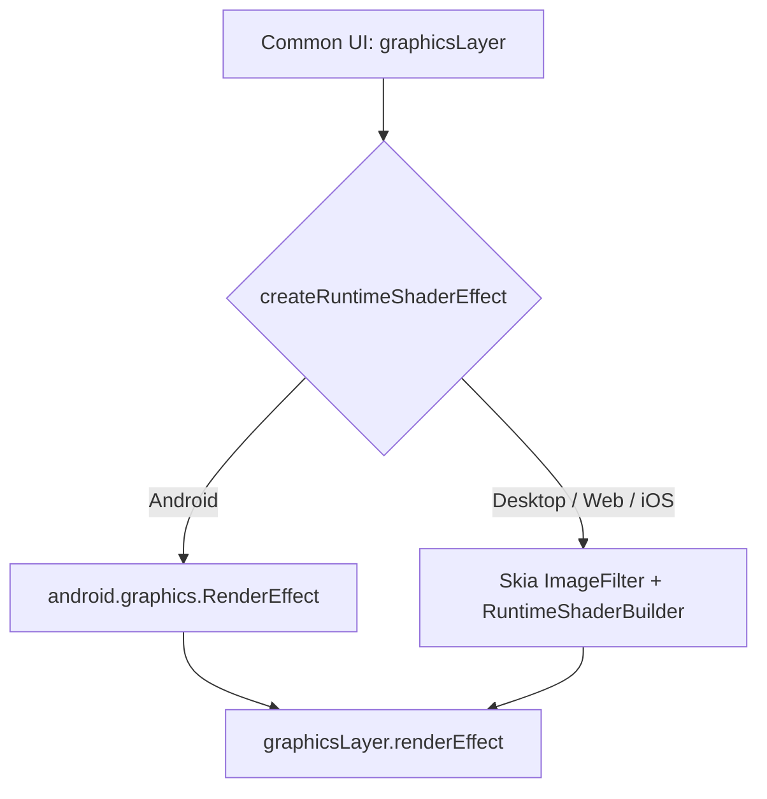

# Guide: Multiplatform Custom Shaders and RenderEffects in Compose Multiplatform

This document explains in detail how we achieved portable, high-performance custom shader rendering and live UI distortion (RenderEffects) across **Android, Desktop (JVM), Web (Wasm), and iOS** using Compose Multiplatform and Skia.

---

## 1. The Challenge

In native Android development (API 33+), developers can use AGSL (Android Graphics Shading Language) to write custom fragment shaders. These shaders can be applied in two main ways:
1. **Generative Backgrounds**: Drawn via a `ShaderBrush` using `RuntimeShader`.
2. **Content Distortion (RenderEffects)**: Distorting live UI elements (like scrollable lists, text, and animations) by applying a `RenderEffect.createRuntimeShaderEffect(shader, "content")` to a View or a Compose `graphicsLayer`.

However, in Compose Multiplatform:
* `android.graphics.RuntimeShader` and `android.graphics.RenderEffect` are JVM/Android-only classes.
* Non-Android platforms (Desktop, Web, iOS) run on **Skia/Skiko** instead of the Android graphics pipeline.
* There is no built-in, common API in Compose Multiplatform to compile custom shaders or apply them as live `RenderEffect` filters on arbitrary Compose layouts.

---

## 2. The Solution Architecture

To solve this, we designed a unified abstraction using Kotlin Multiplatform's `expect`/`actual` mechanism. We bridged the Android graphics APIs with Skia's native C++ shading APIs exposed via **Skiko**.



---

## 3. Creating Custom `RenderEffect`s on All Platforms

To distort a live Compose UI hierarchy, we need to capture the drawing of the children, pass it as an input texture (usually named `content`) to our custom shader, run the shader, and draw the distorted result.

We declared the following `expect` function in `commonMain`:

```kotlin
// commonMain/kotlin/pro/jayeshseth/devcontrols/platform/Capabilities.kt
expect fun createRuntimeShaderEffect(
    shaderSource: String,
    uniformNames: List<String>,
    uniforms: Map<String, Any>,
    inputShaderName: String
): androidx.compose.ui.graphics.RenderEffect?
```

### A. Android Implementation (API 33+)
On Android, we use the system `RuntimeShader` and wrap it using the platform's `RenderEffect`:

```kotlin
// androidMain/kotlin/pro/jayeshseth/devcontrols/platform/Capabilities.android.kt
import androidx.compose.ui.graphics.asComposeRenderEffect

actual fun createRuntimeShaderEffect(
    shaderSource: String,
    uniformNames: List<String>,
    uniforms: Map<String, Any>,
    inputShaderName: String
): androidx.compose.ui.graphics.RenderEffect? {
    if (android.os.Build.VERSION.SDK_INT < android.os.Build.VERSION_CODES.TIRAMISU) return null
    try {
        val shader = android.graphics.RuntimeShader(shaderSource)
        uniforms.forEach { (name, value) ->
            when (value) {
                is Float -> shader.setFloatUniform(name, value)
                is androidx.compose.ui.geometry.Offset -> shader.setFloatUniform(name, value.x, value.y)
                is androidx.compose.ui.graphics.Color -> {
                    shader.setFloatUniform(name, value.red, value.green, value.blue, value.alpha)
                }
                is FloatArray -> shader.setFloatUniform(name, value)
            }
        }
        return android.graphics.RenderEffect.createRuntimeShaderEffect(shader, inputShaderName).asComposeRenderEffect()
    } catch (e: Exception) {
        return null
    }
}
```

### B. Skia Implementation (Desktop, Web, iOS)
On non-Android platforms, we leverage Skia's **`RuntimeShaderBuilder`** and **`ImageFilter`** APIs:

1. **Compile the Shader**: We compile the shader source using `RuntimeEffect.makeForShader(shaderSource)`.
2. **Bind Uniforms**: We instantiate a `RuntimeShaderBuilder` from the compiled effect. Unlike raw byte-buffer packing, `RuntimeShaderBuilder` allows setting uniforms dynamically by name:
   * `builder.uniform(name, float)`
   * `builder.uniform(name, float1, float2)`
   * `builder.uniform(name, floatArray)`
3. **Create the ImageFilter**: We call `ImageFilter.makeRuntimeShader`. We pass:
   * The `RuntimeShaderBuilder` containing our compiled shader and bound uniforms.
   * The `shaderName` (e.g., `"content"`), which tells Skia which uniform sampler represents the input texture.
   * `input = null`. Passing `null` as the input image filter tells Skia to **default to the source content of the layer** (i.e., the rendered pixels of the Compose children).
4. **Convert to Compose RenderEffect**: We convert the Skia `ImageFilter` into a Compose-compatible `RenderEffect` using the extension function `imageFilter.asComposeRenderEffect()`.

```kotlin
// desktopMain / webMain / iosMain
import androidx.compose.ui.graphics.asComposeRenderEffect

actual fun createRuntimeShaderEffect(
    shaderSource: String,
    uniformNames: List<String>,
    uniforms: Map<String, Any>,
    inputShaderName: String
): androidx.compose.ui.graphics.RenderEffect? {
    try {
        val effect = org.jetbrains.skia.RuntimeEffect.makeForShader(shaderSource)
        val builder = org.jetbrains.skia.RuntimeShaderBuilder(effect)
        
        uniforms.forEach { (name, value) ->
            when (value) {
                is Float -> builder.uniform(name, value)
                is androidx.compose.ui.geometry.Offset -> builder.uniform(name, value.x, value.y)
                is androidx.compose.ui.graphics.Color -> {
                    builder.uniform(name, value.red, value.green, value.blue, value.alpha)
                }
                is FloatArray -> builder.uniform(name, value)
            }
        }
        
        val imageFilter = org.jetbrains.skia.ImageFilter.makeRuntimeShader(
            runtimeShaderBuilder = builder,
            shaderName = inputShaderName,
            input = null
        )
        return imageFilter.asComposeRenderEffect()
    } catch (e: Exception) {
        return null
    }
}
```

---

## 4. Distorting the Compose UI Tree

With the `createRuntimeShaderEffect` API ready, we can apply it to any Compose layout. Here is how we implemented the **Touch Ripple Water** effect on a scrollable grid of 80 numbered boxes with staggered reveal animations:

### The Ripple Shader
The shader samples the `content` input at a distorted coordinate offset. The offset is calculated by summing the wave contributions of up to 8 active touch ripples:

```glsl
uniform shader content;
uniform float2 iResolution;
uniform float iTime;
uniform float rippleCount;
uniform float ripples[24]; // 8 ripples × (x, y, startTime)

half4 main(float2 fragCoord) {
    float2 off = float2(0.0);
    for (int i = 0; i < 8; i++) {
        if (float(i) >= rippleCount) break;
        float2 c = float2(ripples[i * 3], ripples[i * 3 + 1]);
        float age = iTime - ripples[i * 3 + 2];
        if (age < 0.0) continue;
        float2 d = fragCoord - c;
        float dist = length(d) + 0.001;
        // Sinusoidal wave with exponential time and distance falloff
        float w = sin(dist * 0.09 - age * 7.0) * exp(-age * 2.2) * exp(-dist * 0.004) * 22.0;
        off += (d / dist) * w;
    }
    return content.eval(fragCoord + off);
}
```

### The Compose Multiplatform Layout
We wrap the scrollable `LazyVerticalGrid` inside a container and apply the `RenderEffect` to its `graphicsLayer`:

```kotlin
Box(
    Modifier
        .fillMaxSize()
        .graphicsLayer {
            // Apply the compiled multiplatform RenderEffect
            if (effect != null) {
                renderEffect = effect
            }
        }
        .pointerInput(Unit) { detectTapGestures { addRipple(it.x, it.y) } }
        .pointerInput(Unit) { detectDragGestures { c, _ -> addRipple(c.position.x, c.position.y) } }
) {
    LazyVerticalGrid(
        columns = GridCells.Fixed(3),
        modifier = Modifier.fillMaxSize().background(Color(0xFF0B0B16)).padding(8.dp)
    ) {
        itemsIndexed((1..80).toList()) { index, item ->
            val anim = remember { Animatable(0f) }
            LaunchedEffect(Unit) {
                anim.snapTo(0f)
                delay(index * 25L)
                anim.animateTo(1f, tween(450))
            }
            
            Box(
                Modifier
                    .padding(6.dp)
                    .aspectRatio(1f)
                    .graphicsLayer {
                        alpha = anim.value
                        translationY = (1f - anim.value) * 50f
                        val s = 0.85f + anim.value * 0.15f
                        scaleX = s
                        scaleY = s
                    }
                    .background(
                        color = Color.hsv((item * 22f) % 360f, 0.65f, 0.9f),
                        shape = RoundedCornerShape(14.dp)
                    ),
                contentAlignment = Alignment.Center
            ) {
                Text(
                    text = "$item",
                    color = Color.White,
                    fontWeight = FontWeight.Bold
                )
            }
        }
    }
}
```

---

## 5. Key Takeaways & Performance

1. **Zero Layout Redraw Cost**: The shader distortion is applied entirely on the GPU during the compositing phase of the `graphicsLayer`. Scrolling the grid and running the stagger animations does not trigger CPU-side bitmap copies or texture re-uploads.
2. **Dynamic Uniform Binding**: By utilizing Skia's `RuntimeShaderBuilder` instead of raw byte buffers, we avoided writing platform-specific float-endianness packers. Uniforms are set safely by name, matching the simplicity of Android's `RuntimeShader` API.
3. **Implicit Layer Content Binding**: By passing `null` to Skia's `ImageFilter.makeRuntimeShader` input parameter, Skia automatically binds the layer's backing texture as the `content` shader sampler, making the shader integration completely seamless.
