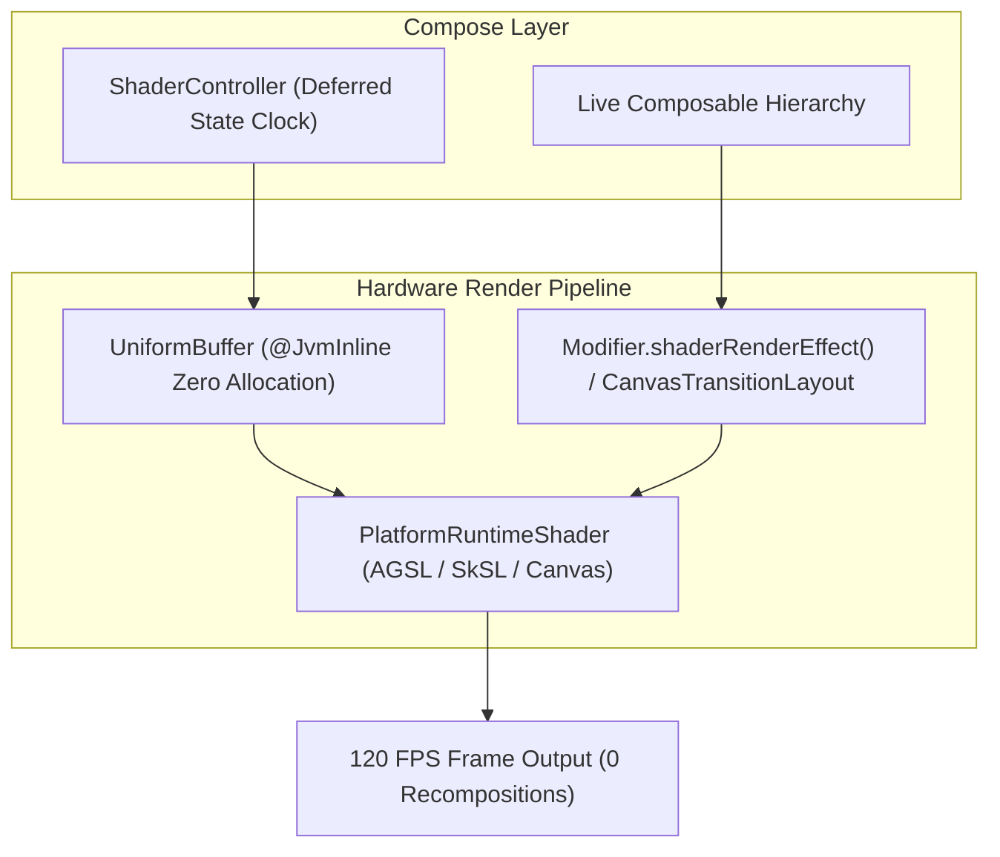

# :shader-engine: — Zero-Recomposition Cross-Platform VFX Engine

`:shader-engine:` is a standalone Kotlin Multiplatform (KMP) graphics library delivering high-performance UI post-processing filters, fullscreen generative shaders, and dual-input transitions running at 60/120 FPS across **Android (AGSL, API 33+)**, **Compose Multiplatform Skia (Desktop JVM / iOS / Web)**, and a **100% shader-free Pure Canvas fallback down to Android 5.0 (API 21+)**.

---

## 1. Architectural Overview & Invariants

### Core Pipeline Invariants
1. **Zero Recompositions / Frame**:
   All dynamic uniform reads (time, pointer touch coordinates, sensor gyro tilt, transition progress) occur deferred inside Compose's drawing and graphics layer phase (`graphicsLayer { ... }`, `drawWithContent { ... }`). The Composable tree is never re-measured or re-laid out during animations.
2. **FP32 Spatial Coordinates**:
   All coordinate parameters (`fragCoord`, `resolution`, `pointer`) and continuous timestamps (`time`) are strictly computed in 32-bit `float`. Using `half` or FP16 for coordinates causes noticeable vertex and texture jitter on resolutions above 1024px.
3. **Premultiplied Alpha Invariant**:
   To prevent color blowout and clipping on Wide-Gamut (Display P3) and HDR screens, all shader color outputs enforce:
   $$\text{finalRGB} = \min(\text{color.rgb}, \text{half3}(\text{color.a}))$$
4. **Tile-Based GPU Early-Outs**:
   On mobile Adreno and Mali tile-based deferred renderers (TBDR), fragments outside active lens regions immediately execute `return content.eval(fragCoord);`, preventing expensive transcendental math from executing on empty pixels.
5. **Card B Zero-Visibility Invariant (Transitions)**:
   During transitions, the incoming layout (Card B) is strictly guaranteed to have $0\%$ visibility when $\text{progress} \le 0.001$, preventing popping defects through geometric clipping (`clipPath`, `clipRect`) or quadratic alpha compositing.

---

## 2. Interactive UI Lenses Catalog (9 Presets)

Lenses filter live, interactive Compose UI components beneath them via `Modifier.shaderRenderEffect()`:

| Preset | Optics & Mathematical Model | Dynamic Parameters |
| :--- | :--- | :--- |
| **`CHROMATIC_FERROFLUID`** | Magnetic liquid displacement, smooth-min ($s_{min}$) surface tension, dynamic specular highlight arc. | `dispersion`, `warpIntensity`, `surfaceTension` |
| **`FROSTED_PRISM_GLASS`** | Snell's law refraction ($n = 1.52$), chromatic dispersion edge fringe, micro-facet surface roughness. | `refraction`, `dispersion`, `roughness` |
| **`SHOCKWAVE_RIPPLE`** | Touch-centered sinusoidal kinetic wave propagation with damping and chromatic dispersion. | `amplitude`, `frequency`, `dispersion` |
| **`FROSTED_ACRYLIC`** | Dual Kawase blur approximation kernel with blue-noise dithering to eliminate 8-bit color banding. | `blurRadius`, `noiseDither`, `tintOpacity` |
| **`CYBERPUNK_HOLOGRAM`** | CRT barrel warp curvature, horizontal phosphor scanlines, and periodic sync-loss glitch jitter. | `barrelWarp`, `scanlineDark`, `glitchRate` |
| **`MAGNIFYING_DOME`** | Spherical glass loupe ($1.75\times$ zoom) centered on pointer with radial chromatic fringe and rim darkening. | `p1` (Magnification), `p2` (Radius), `p3` (Chroma) |
| **`THERMAL_FLIR`** | False-color infrared thermal imaging (Ironbow: Indigo $\to$ Magenta $\to$ Orange $\to$ White) with sensor noise. | `p1` (Contrast), `p2` (Scanlines), `p3` (Noise) |
| **`RAINY_WINDOW`** | Procedural raindrops and vertical trailing streaks with surface-tension normal vector refraction. | `p1` (Density), `p2` (Refraction), `p3` (Mist) |
| **`NIGHT_VISION`** | Gen-3 military P-43 phosphor spectral amplification with photon scintillation and optical vignetting. | `p1` (Gain), `p2` (Scintillation), `p3` (Vignette) |

---

## 3. Dual-Input Transitions Catalog (41 Presets across 6 Categories)

Dual-input transitions blend two layout snapshots (`uniform shader imageA; uniform shader imageB;`) in real time:

- **Fluids (5)**: `LIQUID_MELT`, `DOOM_MELT_DRIP`, `WATER_DROPLET_RIPPLE`, `SLIME_VISCOUS_TEAR`, `THERMAL_HEAT_HAZE`.
- **3D & Origami (6)**: `PAGE_CURL_3D`, `HEXAGONAL_PRISM_WIPE`, `ORIGAMI_TRIANGLE_FOLD`, `VENETIAN_BLINDS_3D`, `CIRCLE_IRIS_ZOOM`, `VORONOI_FRACTURE`.
- **Warps & Physics (6)**: `DISPLACEMENT_WAVE`, `RADIAL_SWIRL_VORTEX`, `CROSS_ZOOM_WARP`, `BLACK_HOLE_LENS`, `KALEIDOSCOPE_COLLAPSE`, `QUANTUM_WORMHOLE`.
- **Retro & Glitch (6)**: `CYBER_GLITCH_SLICE`, `PIXELATE_MOSAIC`, `CRT_TV_OFF_COLLAPSE`, `MATRIX_DIGITAL_RAIN`, `RGB_HOLOGRAM_DISSOLVE`, `VHS_ANALOG_DRIFT`.
- **Light & Pyro (4)**: `FIRE_EMBERS_BURN`, `LUMA_STARRY_WIPE`, `PRISM_RAINBOW_SPLIT`, `SUPERNOVA_SHOCKWAVE`.
- **Canvas [API 21+] (14)**:
  - `CIRCULAR_IRIS`, `CLOCK_RADAR_SWEEP`, `DIAGONAL_SLATS`, `DIAMOND_GRID`, `CURTAIN_SPLIT`.
  - `MESH_LIQUID_RIPPLE` & `MESH_SWIRL_VORTEX` (GPU `drawVertices` triangle meshes).
  - `CHROMATIC_RGB_SPLIT` (Hardware `ColorFilter.colorMatrix`).
  - `PIXEL_BAYER_DITHER` (8x8 Bayer dithering matrix).
  - `HALFTONE_DISSOLVE` (2D pop-art halftone dot expansion).
  - `SPIRAL_NAUTILUS` (Archimedean polar spiral path sweep).
  - `DOOR_SWING_3D` (Hinged door cosine horizontal scale with drop shadow).
  - `CONCENTRIC_RINGS` (Staggered multi-annular ripple sequence).
  - `POLYGON_SHATTER` (16 dispersing triangular shards).
